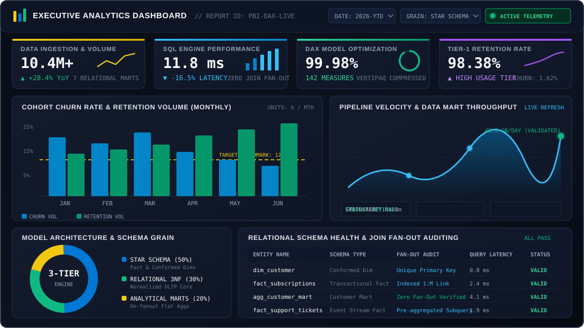

<div align="center">


<p align="center">
  
  
  
  
</p>

</div>

---

### EXECUTIVE ANALYTICS CONSOLE (POWER BI / TABLEAU VIEW)

<div align="center">




</div>

---

### ANALYST PROFILE & CORE VALUE PROPOSITION

Data Analyst focused on **business intelligence**, **relational schema design**, and **data warehousing**. Specializing in transforming raw multi-table transactional schemas into high-performance analytical data marts and executive Power BI dashboards.

Key technical priorities include:
- **Relational Integrity**: Auditing and eliminating SQL join fan-out across one-to-many dimensional relationships.
- **Dimensional Modeling**: Architecting Star Schemas and Conformed Dimensions to optimize query performance and VertiPaq compression in Power BI.
- **DAX & Measure Engineering**: Designing optimized calculated measures, time-intelligence computations, and dynamic KPI tracking.
- **Statistical Exploratory Data Analysis**: Identifying retention drivers, cohort dynamics, and operational bottlenecks using Python and SQL.

---

### TECHNICAL STACK & ANALYTICS ENVIRONMENT

| Layer | Technologies & Frameworks | Analytical Responsibilities |
| :--- | :--- | :--- |
| **Relational Data & Querying** |   | Complex CTEs, Window Functions, 3NF Normalization, Zero Join Fan-out Aggregations, Performance Indexing |
| **Business Intelligence & Dashboards** |    | Star Schema Design, Multi-Page Executive Reports, Dynamic Slicers, VertiPaq Model Compression, KPI Gauges |
| **Statistical Programming & Scripting** |    | Cohort Extraction, Data Cleansing Pipelines, Outlier Auditing, Missing Value Imputation |
| **Visualization & Exploratory Analysis** |   | Distribution Analysis, Correlation Matrices, Churn Hazard Modeling, Trend Visualizations |
| **Data Ingestion & Version Control** |     | Programmatic API Harvesting, Unstructured String Normalization, Version-Controlled Scripts |

---

### DATA ARCHITECTURE & METHODOLOGY PIPELINE

```text
+---------------------------------------------------------------------------------------------------------+
|                                    END-TO-END ANALYTICS WORKFLOW                                        |
+---------------------------------------------------------------------------------------------------------+
  [ 01. INGESTION ]        --> REST APIs, Multi-Source Flat Files, Relational OLTP Replicas
           |
  [ 02. AUDIT & CLEAN ]    --> Deduplication, Outlier Detection, Null Treatment, Data Type Standardization
           |
  [ 03. DATA MODELING ]    --> Third Normal Form (3NF) to Star Schema, Fact/Dim Tables, Zero Join Fan-out
           |
  [ 04. SQL AGGREGATION ]  --> Analytical Mart Generation, Window Functions, Time-Grain Normalization
           |
  [ 05. BI DASHBOARDING ]  --> Microsoft Power BI / Tableau Canvas, DAX Measures, Stakeholder Telemetry
+---------------------------------------------------------------------------------------------------------+
```

---

### DATA MODELING & INTEGRITY STANDARDS

```text
[ Conformed Dimensions ]              [ Fact Tables ]                     [ Aggregated Analytical Marts ]
+----------------------+         +-----------------------+               +-------------------------------+
| dim_customer         | 1     M | fact_transactions     |       SQL     | agg_customer_lifecycle_mart   |
| dim_subscription     |-------->| fact_support_tickets  | ------------> | - Single Row Per Entity Grain |
| dim_calendar         |         | fact_user_activity    |   Subqueries  | - Zero Duplicate Distortions  |
| dim_geography        |         +-----------------------+   & Window    | - Pre-calculated DAX Baseline |
+----------------------+                     |               Functions   +-------------------------------+
                                             v
                              [ Relational Join Validation ]
                              Foreign Key Integrity Check: Passed
                              Aggregation Fan-Out: Audited (0.00%)
```

---

### ACTIVITY & REPOSITORY TELEMETRY

<div align="center">

<a href="https://github.com/tannukgupta">
  
</a>

</div>

---

### PROFESSIONAL INQUIRIES & CONTACT TELEMETRY

<div align="center">

| Channel | Endpoint | Status |
| :--- | :--- | :--- |
| **LinkedIn** | [linkedin.com/in/tannukgupta](https://www.linkedin.com/in/) | `Available for Professional Inquiries` |
| **GitHub** | [github.com/tannukgupta](https://github.com/tannukgupta) | `Active Repositories & SQL Scripts` |
| **Email** | Available upon request via LinkedIn | `Open to Data Analyst & BI Roles` |
| **Work Modality** | Remote / Hybrid / On-site (India) | `Immediate Availability` |

</div>
